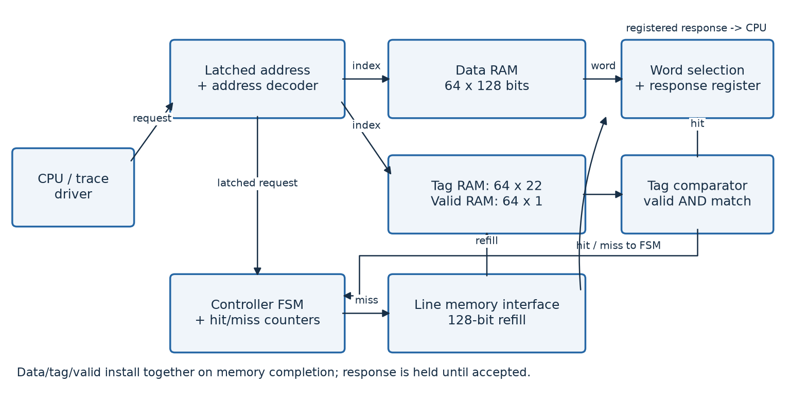

# Project 6: Direct-Mapped Cache Controller

A working Phase I Verilog prototype for a **1 KiB direct-mapped read cache**,
with 16-byte lines, 32-bit byte addresses, atomic refill and independently
checked hit/miss statistics. This continues Samarth Khera's original decoder and FSM
commit without rewriting its history.

**Submission status:** the technical package is implemented and verified.
All five names, enrollment numbers, department and university are confirmed below. Course details,
completed individual contribution records, the final recording and its hosted
URL are still required. See the detailed
[Phase I audit](docs/phase1_audit.md). A draft video does not replace the required
team introductions.

| Phase I requirement | Deliverable |
| --- | --- |
| IEEE report: abstract, literature review, proposed solution, contributions, references | [PDF](docs/report/phase1_report.pdf) · [editable LaTeX](docs/report/phase1_report.tex) |
| Prototype and block diagrams | [Cache RTL](rtl/) · [FSM](cache_fsm.v) · [decoder](addr_decoder.v) · [architecture](docs/architecture.md) |
| Prototype video, maximum five minutes | [3:30 draft MP4](docs/demo/phase1_prototype_draft.mp4) · [Final recording (Google Drive)](https://drive.google.com/drive/folders/1rIy2lJdpMUVboZ0P00hCmf8vu-b3YTjB?usp=sharing) · [video link](docs/demo/video_link.md) |
| Trace, hit/miss report and AMAT | [Traces](traces/) · [measured results](results/summary.csv) · [analysis](docs/results_analysis.md) |
| Synthesis evidence | [Log](results/synthesis.log) · [generic cell statistics](results/synthesis_cells.json) |
| Individual contributions | [Evidence and proposed responsibilities](docs/contributions.md) · [editable team details](team.json) |

## Run and reproduce

Install Python 3.10+, GNU Make, Icarus Verilog, Yosys, Tectonic and ffmpeg.
RTL simulation and synthesis need no Python packages; figures and the draft
video use the packages in `requirements.txt`.

On macOS with Homebrew:

```sh
brew install icarus-verilog yosys tectonic ffmpeg
python3 -m venv .tools/venv  
.tools/venv/bin/python -m pip install -r requirements.txt
make check
```

`make` automatically uses `.tools/venv/bin/python` when present. Tectonic's first
run downloads its LaTeX bundle, including IEEEtran; later runs use its cache.
On Debian/Ubuntu, Icarus, Yosys and ffmpeg are available through apt; install
Tectonic separately or compile the LaTeX report with a full TeX installation.

| Command | What it checks/builds |
| --- | --- |
| `make sim` | 15 actual RTL runs, an independent oracle, exact counters and per-access latency; also emits a VCD |
| `make synth` | Synthesizes the cache only; structural checks and generic cell statistics |
| `make deepcheck` | After synthesis, runs 4,096 high-address stress accesses on RTL and the synthesized netlist and compares every output |
| `make report` | Regenerates figures, measured tables, team fields, analysis and IEEE PDF; run simulation and synthesis first |
| `make demo` | Generates the captioned 210-second rehearsal video from actual result files and figures |
| `make check` | Runs simulation, synthesis, stress/netlist checks, report, video and package validation in order |
| `make submission-check` | Strict readiness check; flags pending course details, contribution evidence and final video/submission requirements |

Generated waveforms, binaries and synthesized netlists are under `build/` and
are not committed. Small measured CSV/JSON/log files, diagrams, PDF and draft
video are included so reviewers can inspect results without rebuilding.
GitHub Actions runs simulation, synthesis and the additional netlist check on
pushes and PRs and preserves the evidence as an artifact.

## Design

The address is divided into **tag `[31:10]`, index `[9:4]`, offset `[3:0]`**.
The index selects one of 64 lines, `offset[3:2]` selects a word, and valid plus
tag equality determines a hit. An aligned block is installed atomically on a
miss. The FSM is IDLE → COMPARE → ALLOCATE (miss only) → RESPOND → IDLE.
RESPOND retains data and status until accepted. Reset invalidates all lines.



The [interface specification](docs/architecture.md) defines acceptance,
backpressure, alignment errors, reset cancellation, memory completion and
counter semantics. The baseline supports aligned reads. Write policies, a CPU
core, AXI/DRAM integration and an FPGA board demonstration are future work.
The memory endpoint is a deterministic simulation model, not physical DRAM.


## Understanding Cache Address Mapping

A direct-mapped cache uses specific address bits to determine
where a memory block can be stored. In this implementation,
a 32-bit memory address is divided into three fields:

| Address Field | Bit Range | Purpose |
|---|---|---|
| Tag | [31:10] | Identifies the memory block |
| Index | [9:4] | Selects one of the 64 cache lines |
| Offset | [3:0] | Selects a byte within a 16-byte block |

### Address Mapping Example

Consider two memory addresses:

- Address A: `0x00000024`
- Address B: `0x00000424`

Their address fields are:

| Field | Address A | Address B |
|---|---|---|
| Tag | `0x000000` | `0x000001` |
| Index | `0x02` | `0x02` |
| Byte Offset | `0x4` | `0x4` |

Although these addresses belong to different memory blocks,
both map to cache line 2.

This happens because a direct-mapped cache allows only one
memory block to occupy a particular cache index at a time.

### Understanding Conflict Misses

Assuming the cache is initially empty, consider this
sequence of memory accesses:

| Access | Address | Cache Result |
|---|---|---|
| 1 | `0x00000024` | Miss |
| 2 | `0x00000024` | Hit |
| 3 | `0x00000424` | Miss |
| 4 | `0x00000024` | Miss |

The first access loads Address A into cache line 2.
The second access is a hit because the block is already present.

When Address B is accessed, it maps to the same cache line
but has a different tag. The previously stored block is
therefore replaced.

Revisiting Address A produces another miss because its
cache entry has been evicted.

### Key Observation

This example demonstrates an important limitation of
direct-mapped caches: two frequently accessed memory blocks
can continuously replace one another if they map to the
same cache index.

Increasing cache associativity can reduce such conflict
misses by allowing multiple blocks to occupy the same set.

Understanding this behavior is essential when evaluating
cache hit rates, miss penalties and Average Memory Access
Time (AMAT).

## Measured results

Each main workload starts cold and contains 1,024 reads. The random trace uses
seed 6; the conflict trace alternates addresses 0 and 0x400.

| Workload | Hits | Misses | Hit rate | AMAT (cycles) |
| --- | ---: | ---: | ---: | ---: |
| Sequential | 768 | 256 | 75.00% | 2.500000 |
| Repeated | 1,008 | 16 | 98.44% | 1.093750 |
| Seeded random | 233 | 791 | 22.75% | 5.634766 |
| Conflict | 0 | 1,024 | 0.00% | 7.000000 |

At default memory-model latency 5, a hit takes 1 cycle and a miss 7, so the
**additional** miss penalty is 6 cycles: `AMAT = 1 + miss_ratio × 6`. Measured
means agree with that formula. The measurement ends when response-valid first
appears; it excludes response backpressure and gaps between requests. It does
not measure throughput or hardware Fmax.

Each regression run includes 142 directed read checks and reset-abort scenarios.
The separate full-address stress regression checks RTL and the synthesized
netlist against the same address-based oracle. These checks provide concrete
evidence; they are not exhaustive formal verification.

## Team and submission

**Department:** Computer Science and AI

**College / university:** Rishihood University

| Team member | Enrollment number |
| --- | --- |
| Navprabhat Singh | 2401010293 |
| Samarth Khera | 2401010407 |
| Pratham Malhotra | 2401010343 |
| Shivansh Tiwari | 2401020108 |
| Tattva Rajput | 2401010478 |

The confirmed roster is maintained in `team.json` and appears in the report and
demo materials. The department is Computer Science and AI at Rishihood University;
the course title remains pending. Record
completed individual contributions with actual commit evidence, then rebuild
the report. Proposed roles are not completed contribution credits.

The new implementation and deliverables were prepared with AI assistance.
Each team member should review and understand their work, make a substantive
contribution, and commit it using their own Git identity. Preserve genuine
history; do not manufacture five-author contributions.

Record the prototype presentation with all five group members introduced by
name, keep the video under five minutes, host it with evaluator access and update
[the final link](docs/demo/video_link.md). Run `make submission-check`, review
the [audit checklist](docs/phase1_audit.md), then submit this repository URL:

[samarth-khera/Direct-Mapped-Cache-Project](https://github.com/samarth-khera/Direct-Mapped-Cache-Project)

[Instructor submission form](https://docs.google.com/forms/d/e/1FAIpQLSc6Cx8OrOQLGj_X2ZMkyG5jc8mokq36mGRq2x8jGRNV1sbegA/viewform)
